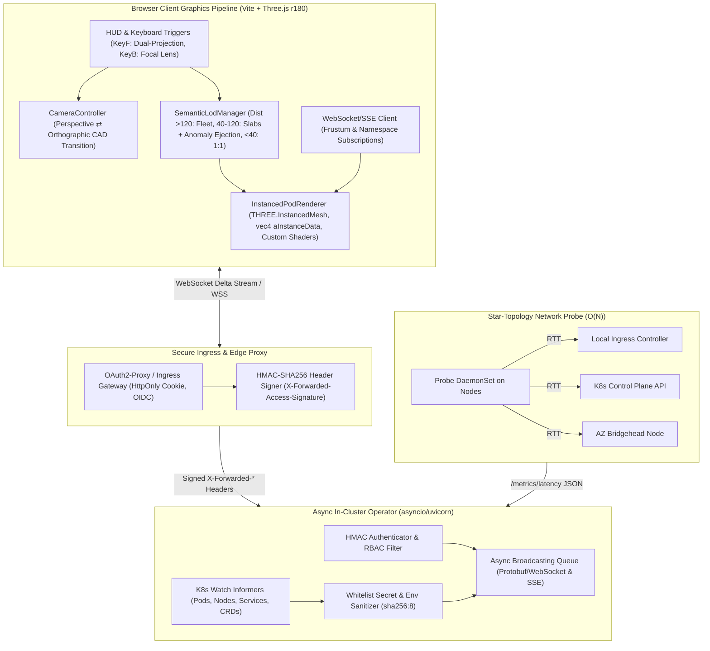

# Architectural Blueprint: Next-Gen Instanced GPU Pipeline, Semantic LOD, Zero-Trust Hardening & Dual-Projection (SPEC-13)

**Architectural Target:** `cluster-vis`  
**Reference Specification:** `specs/13-next-gen-instanced-lod-security-hardening-and-dual-projection.md`  
**Status:** Approved / In Implementation  
**Key Systems:** WebGL Shader Pipeline, Semantic LOD, OAuth2-Proxy Ingress, Async Operator, Star-Topology Probe, Orthographic Dual-Projection  

---

## 1. Executive Architecture & Motivation

SPEC-13 delivers enterprise-grade scalability and incident-triage capabilities to the Cluster Visualizer while upholding its core identity: *"To give humans a way to understand cluster topology in a more physical way, by representing complex distributed systems in 3D space."*

Prior iterations used individual Three.js meshes per pod and synchronous operator broadcasting, which hits strict performance ceilings at $\ge 500$ nodes and $\ge 10,000$ pods. SPEC-13 solves these bottlenecks through four architectural pillars:
1. **Instanced GPU Rendering & Semantic LOD:** Single-draw-call `THREE.InstancedMesh` capsule and tray pipelines driven by vertex buffer attributes (`vec4 aInstanceData`), paired with **Anomaly Outlier Ejection** that aggregates healthy pods into slabs while physically ejecting failing pods into 3D space.
2. **Zero-Trust Security & Tiered Ingress Hardening:** Removal of browser-retained bearer tokens, mandatory `OAuth2-Proxy` cookie authentication with HMAC-SHA256 header verification, and strict whitelist-only manifest extraction schemas.
3. **Async Concurrency & Delta Streaming:** Migration of the operator to an `asyncio` streaming server with Protobuf/WebSocket delta encoding and viewport frustum filtering, backed by an $O(N)$ Star-Topology Network Probe.
4. **Dual-Projection CAD Mode & Incident Focal Lens:** Instant smooth camera transition (`KeyF`) between 3D Isometric Elevation and 2.5D Orthographic Floor-Cut CAD mode, plus blast-radius focus (`KeyB`).

---

## 2. End-to-End System Flow & Architecture Diagram



---

## 3. Detailed Component Interfaces & Schemas

### 3.1 Instanced GPU Memory & Shader Contracts (`src/scene/instanced_pod_renderer.ts`)

```typescript
export interface InstanceDataBuffer {
  instanceMatrix: THREE.InstancedBufferAttribute; // 16 floats (4x4 matrix)
  aInstanceData: THREE.InstancedBufferAttribute;  // 4 floats:
                                                  // x: status_code (0=Healthy, 1=CrashLoop, 2=OOM, 3=Pending)
                                                  // y: cpu_utilization_ratio (0.0 - 2.0)
                                                  // z: mem_utilization_ratio (0.0 - 2.0)
                                                  // w: diff_state (0=identical, 1=skew, 2=missing, 3=added)
}

export interface PodInstanceRecord {
  id: string;
  podName: string;
  namespace: string;
  nodeName: string;
  statusCode: number;      // 0=Healthy, 1=CrashLoop, 2=OOM, 3=Pending
  cpuRatio: number;        // CPU actual/request
  memRatio: number;        // Mem actual/request
  diffState: number;       // 0=identical, 1=skew, 2=missing, 3=added
  position: [number, number, number];
  scale: [number, number, number];
  quaternion: [number, number, number, number];
  isEjectedOutlier: boolean;
}

export interface IInstancedPodRenderer {
  initialize(maxPods?: number): void;
  syncPods(pods: PodInstanceRecord[]): void;
  updatePod(podId: string, updates: Partial<PodInstanceRecord>): void;
  removePod(podId: string): void;
  setEjectionState(podId: string, ejected: boolean): void;
  updateAnimation(deltaTime: number): void;
  dispose(): void;
}
```

### 3.2 Semantic LOD & Anomaly Outlier Ejection (`src/scene/semantic_lod.ts`)

```typescript
export enum LodTier {
  FLEET = 0,       // Camera Dist > 120: Global namespace boundary hulls & summary counters
  STRATUM = 1,     // Camera Dist 40 - 120: Workload Aggregation Slabs + Anomaly Ejection
  INSPECTION = 2,  // Camera Dist < 40: 1:1 Discrete proportional instanced capsules
}

export interface WorkloadSlabAggregate {
  namespace: string;
  workloadName: string;
  kind: string;
  podCount: number;
  healthyCount: number;
  anomalousCount: number;
  centroid: [number, number, number];
  dimensions: [number, number, number];
  statusPillText: string;
}

export interface AnomalyOutlierPod {
  podId: string;
  workloadName: string;
  namespace: string;
  reason: 'CrashLoopBackOff' | 'ImagePullBackOff' | 'OOMKilled' | 'Pending' | 'Morphing';
  nodeSlotPosition: [number, number, number];
  parentSlabPosition: [number, number, number];
  tractorTension: number;
}
```

### 3.3 Zero-Trust Ingress & HMAC Authentication Protocol (`src/operator/auth.py`)

```python
from dataclasses import dataclass, field
from typing import List, Optional

@dataclass
class AuthResult:
    authenticated: bool
    user: str = ""
    groups: List[str] = field(default_factory=list)
    email: Optional[str] = None
    error: Optional[str] = None

class HMACAuthenticator:
    """Validates X-Forwarded-* headers signed by OAuth2-Proxy sidecar."""
    def __init__(self, shared_secret: str, max_drift_seconds: int = 300):
        self.shared_secret = shared_secret.encode("utf-8")
        self.max_drift_seconds = max_drift_seconds

    def verify_headers(
        self,
        user: str,
        groups: str,
        timestamp: str,
        received_signature: str
    ) -> AuthResult:
        ...
```

### 3.4 Star-Topology Latency Network Probe (`src/probe/main.py`)

```python
@dataclass
class ProbeTarget:
    target_type: str  # "ingress" | "api" | "az_bridge"
    host: str
    port: int
    az: Optional[str] = None

class StarTopologyProbeDaemon:
    def __init__(
        self,
        node_name: str,
        host_ip: str,
        az_zone: str,
        targets: List[ProbeTarget],
        probe_interval_seconds: float = 3.0,
        timeout_ms: int = 500,
    ):
        ...
```

### 3.5 Dual-Projection CAD Mode & Focal Lens (`src/scene/camera_controller.ts`)

```typescript
export interface DualProjectionState {
  isOrthographic: boolean;
  transitionProgress: number; // 0.0 (Perspective) -> 1.0 (Orthographic CAD)
  perspectiveCamera: THREE.PerspectiveCamera;
  orthographicCamera: THREE.OrthographicCamera;
  activeCamera: THREE.Camera;
  cadGridVisible: boolean;
}

export interface FocalLensState {
  isActive: boolean;
  focusedTargetId: string | null;
  dimmedOpacity: number; // default 0.15
  blastRadiusNodeIds: Set<string>;
  blastRadiusEdgeIds: Set<string>;
}
```

---

## 4. Architectural Decision Records (ADRs)

### ADR-1301: Unified InstancedMesh vs Individual Procedural Meshes
- **Context:** At 10,000 pods, procedural mesh instantiation results in ~25,000 draw calls and 500MB VRAM footprint, dropping frame rates to 5–15 FPS.
- **Decision:** Migrate to a unified `InstancedPodRenderer` using `THREE.InstancedMesh` with GPU-side shader attributes (`aInstanceData`).
- **Consequences:** Limits scene draw calls to $\le 30$ per viewport ($\le 120$ in Quad mode). VPA sizing and alert pulsing run entirely in vertex/fragment shaders.

### ADR-1302: Semantic LOD with Anomaly Outlier Ejection
- **Context:** Individual rendering collapses WebGL at large scale, yet hiding pods in coarse bounding boxes blinds SREs to localized failures.
- **Decision:** Aggregate healthy workloads into slabs at medium/fleet zoom, but physically eject anomalous workloads (`CrashLoopBackOff`, `OOMKilled`, `Pending`) as autonomous 3D glowing capsules connected by luminous tractor lines.
- **Consequences:** Near-constant GPU overhead (<500 draw calls scene-wide) with zero cognitive lag for incident detection.

### ADR-1303: OAuth2-Proxy Sidecar vs Browser TokenReview
- **Context:** Storing raw Kubernetes ServiceAccount bearer tokens in browser `sessionStorage` with CORS `*` is an XSS and credential-leak liability.
- **Decision:** Deprecate client bearer token input. Mandate an `OAuth2-Proxy` sidecar with `HttpOnly; Secure; SameSite=Strict` cookies and HMAC-SHA256 signature verification on forwarded headers.
- **Consequences:** Browser JavaScript never touches cluster tokens. Eliminates wildcard CORS vulnerabilities.

### ADR-1304: Dual-Projection Perspective/Orthographic CAD Switch (`KeyF`)
- **Context:** 3D isometric elevation excels at spatial stratification and depth, but introduces perspective foreshortening and visual occlusion during emergency incident triage.
- **Decision:** Implement a smooth 600ms transition between 3D Perspective and 2.5D Orthographic CAD floor-cut mode triggered by `KeyF`.
- **Consequences:** Operators seamlessly toggle between physical architectural intuition and planar schematic clarity.

### ADR-1305: $O(N)$ Star-Topology Probe with Optional eBPF
- **Context:** Full $O(N^2)$ all-to-all TCP SYN meshes exhaust conntrack tables on clusters $\ge 100$ nodes.
- **Decision:** Restrict probe targets to a star topology: local Ingress, API server, and regional AZ bridgeheads ($K \le 5$ connections per node).
- **Consequences:** Linear scaling $O(N \cdot K)$ across 5,000+ nodes without flooding the host network.

---

## 5. 💡 Note to Future Self: Hosting Portability

A core design imperative of `cluster-vis` is **zero vendor lock-in and seamless cloud/edge decoupling**:

1. **Dual Operating Modes (Standalone vs In-Cluster):**
   - **Local / Edge Developer Mode:** The frontend runs as a static SPA (Vite) loading pre-baked JSON sample catalogs (`public/data/samples/`) or reading offline cluster exports (`cluster-vis dump`). In this mode, no Kubernetes cluster, operator, or OAuth2 proxy is required. Authentication defaults to `mode="none"`.
   - **In-Cluster Enterprise Mode:** The frontend is served behind an Ingress controller with an `oauth2-proxy` sidecar. The operator runs as an in-cluster Deployment within `clustervis-system`.
2. **Pluggable Identity Decoupling:**
   - Identity verification in `src/operator/auth.py` is protocol-agnostic. It trusts HMAC-signed headers whether injected by Cloudflare Access, Google Cloud IAP, AWS ALB OIDC, Dex, or standalone OAuth2-Proxy.
   - The operator never couples directly to vendor-specific IAM SDKs (no hard AWS/GCP/Azure library dependencies).
3. **Headless & Embedded Fallback:**
   - WebGL shaders and instancing degrade gracefully on low-power devices. If WebGL2 instancing is restricted, Semantic LOD automatically defaults to aggregated slabs (LOD 0/1) to protect frame rates.
